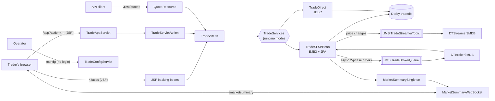

# DayTrader 8: how it does it

## Runtime

| Part | Technology | Where |
|---|---|---|
| Server | Open Liberty (`open-liberty:full` image), Java EE 8 features: EJB 3.2, Servlet 4.0, JSF 2.3, JPA 2.2, MDB 3.2, JMS 2.0, CDI 2.0, WebSocket 1.1, JAX-RS 2.1, JSON-P/B, Bean Validation 2.0 | `src/main/liberty/config/server.xml` |
| Web UI 1 (default) | JSP pages via `TradeAppServlet` (`/app?action=…`) | `web/servlet/`, `webapp/*.jsp` |
| Web UI 2 | JSF (`*.faces`, `.xhtml`) with backing beans | `web/jsf/`, `webapp/*.xhtml` |
| REST | JAX-RS: `GET /rest/quotes/{symbols}`, `POST /rest/quotes`, broadcast events | `jaxrs/` |
| Streaming | WebSocket `/marketsummary`; JMS topic `TradeStreamerTopic` consumed by `DTStreamer3MDB` | `web/websocket/`, `mdb/` |
| Business logic | `TradeServices` with three interchangeable implementations: EJB3 + JPA (default), direct JDBC, session bean to JDBC | `impl/ejb3/`, `impl/direct/`, `impl/session2direct/` |
| Order processing | Synchronous (default), asynchronous (managed executor), or two-phase via JMS queue `TradeBrokerQueue` and `DTBroker3MDB` | `impl/`, `mdb/` |
| Data | Embedded Derby 10.14, database `tradedb`, prebuilt in `resources/data` | see `data-inventory.md` |

Size: 141 Java files (about 19,900 lines), 38 JSP and XHTML pages. One existing "test" (`TestServlet`) is a servlet, not an automated test.

## Build, test and tooling

- Maven (`pom.xml`), Liberty Maven plugin 3.3-M4, Java EE API 8.0. No unit or integration tests.
- JMeter workloads in `jmeter_files/` (with and without WebSockets, JSP and JSF variants).
- Here: `legacy/docker/Dockerfile` builds the WAR in a Maven container and runs it on Open Liberty, unchanged. CI does the same before running the characterisation tests.

## Diagram

## What the characterisation tests run against

The default configuration only: JSP interface, EJB3 runtime mode, synchronous orders. The other modes are alternative implementations of the same behaviour, kept for benchmarking; whether the new slice needs any of them is a gate decision (`requirements.md`, "Scope").
