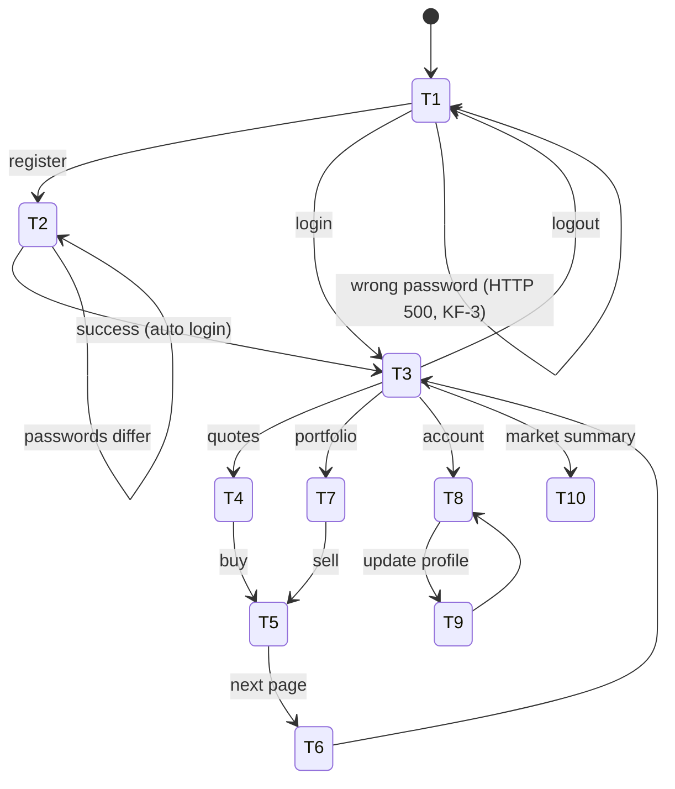

# DayTrader 8: users, states and journeys

## Users

| User | How they use it | Priority |
|---|---|---|
| **Trader** (consumer) | Browser, JSP pages (or JSF pages) | Primary |
| **API client** (client software) | `GET /rest/quotes/{symbols}`; WebSocket `/marketsummary` | Secondary: public interface other software may depend on |
| **Operator** | `/config`: settings, reset, rebuild database; `runStats.jsp` | Secondary |
| **Load tester** | JMeter scripts in `jmeter_files/`, primitives under `/servlet/Ping*` | Source of non-functional requirements; primitives are a scope question |

No upstream services: the app calls nothing outside itself.

## Trader states

| ID | State | Entered by | Risk |
|---|---|---|---|
| T1 | Anonymous (welcome page) | First visit, logout, any error on login | Low |
| T2 | Registering | Register link | **Medium:** stores password and card number; sets opening balance |
| T3 | Logged in, home | Login or registration | Medium: login counts and last login |
| T4 | Viewing quotes | Quotes page, symbol links | Low (read only) |
| T5 | Order submitted / order page | Buy or sell | **High: money** |
| T6 | Order alert shown | First page after an order completes | **High: data loss** (KF-7) |
| T7 | Viewing portfolio | Portfolio page | Medium: gain and loss figures |
| T8 | Viewing account and profile | Account page | Medium: shows card number and email |
| T9 | Updating profile | Account page form | **Medium:** password change |
| T10 | Market summary | Market summary page or WebSocket | Low |

## Operator states

| ID | State | Risk |
|---|---|---|
| O1 | Viewing configuration | Low |
| O2 | Changing runtime, order processing or interface mode | Medium: changes behaviour for every user |
| O3 | Resetting trade data / rebuilding the database | **High: data loss, no login needed** (KF-6) |
| O4 | Driving load through the scenario servlet (`/scenario`) | Low: benchmark only (KF-9) |

## Risk ranking (sets the order and depth of work)

1. T5 Trading: balances, fees, holdings, rounding.
2. T6 and O3: data loss (order deletion; unauthenticated reset).
3. T2, T9 and T3: credentials and personal data.
4. T7 and T8: figures derived from money (gains, totals).
5. T4, T10, O1, O2: read-only or operational.

Every state is still covered; the ranking sets how deep the requirements and tests go first.

## Journeys

Transition requirements are in `requirements.md` with the state they leave.
