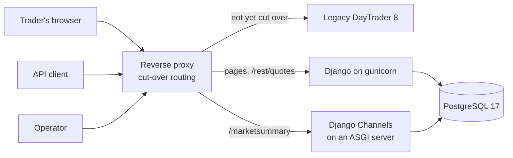

# The new slice: how it will do it (proposed)

**Status:** proposed with RFC-0001; approved or changed at the stack gate. It mirrors `docs/discovery/architecture.md` for the legacy app. Details marked *later* are settled by the remaining Planning steps: the data migration plan, the cut-over plan and the vertical slices.

## Runtime

| Part | Technology | Covers |
|---|---|---|
| Language | Python 3.14 | |
| Web framework | Django 6.1 (6.2 LTS when released) | |
| Web UI | Server-rendered Django templates, one interface (S1) | AUTH-*, TRADE-*, HOME-*, PORT-1, QUOTE-3 |
| Accounts | Django auth: sessions, CSRF, timing-safe login, permissions. Argon2 hashing needs `argon2-cffi` installed and the Argon2 hasher first in `PASSWORD_HASHERS` | AUTH-3N, AUTH-13N, ADMIN-1N |
| Operator pages | Django views behind an operator permission; configuration stored in the database, updated field by field | ADMIN-1N to ADMIN-3N, SEED-1N |
| REST API | Django views at the legacy paths (`/rest/quotes/...`), JSON written with `simplejson` (`use_decimal=True`). `simplejson` writes a `Decimal` at whatever precision it has, so one encoder function rounds every amount to 2 places first, and the WebSocket uses the same function | QUOTE-1, QUOTE-2N, MONEY-1N |
| WebSocket | Django Channels consumer at the legacy path (`/marketsummary`), answering the same messages | MARKET-1, MARKET-2 |
| Money | `Decimal` throughout; `DecimalField` → PostgreSQL `NUMERIC(14,2)`, quantities `NUMERIC(14,4)`; rounding only at the named points (TRADE-7N, HOME-1N, HOME-2N, and before encoding to JSON), half-up | MONEY-1N, TRADE-7N, HOME-1N, HOME-2N, NFR-2 |
| Database | PostgreSQL 17; orders partitioned by month once they grow (*later*: the size that triggers it) | ORDER-1N |
| HTTP servers | gunicorn for pages and the API; an ASGI server for the WebSocket. Whether one ASGI server can serve everything fast enough is measured *later* | NFR-1 |
| Logging | Structured logs with a filter that drops secrets, tested | AUTH-14N |
| Front door | A reverse proxy routing each path to the legacy or new slice: also the cut-over mechanism (*later*) | Cut-over |

## Build, test and tooling

- uv, Ruff and pytest, as in the repository now; pytest-django for unit tests.
- The characterisation tests run against the new slice through a second client with the same methods as `legacy_client.py`. Tests for fixed behaviour (the N requirements) have their expected results changed, each traced to its KF entry.
- Docker Compose: PostgreSQL, the web server, the WebSocket server, and the legacy app alongside for comparison. One command starts it all (NFR-3).
- The same CI and AI review as now. A check fails the build if money code uses `float` (MONEY-1N).
- NFR-1: DayTrader's JMeter workload, adapted to the one web UI (S1), run against both slices on the same machine (`perf/`).

## Diagram

## What it drops (from the gate)

The JSF interface (S1), the three runtime modes and three order-processing modes (S2), the JMS queues and message-driven beans that only served those modes, the benchmark primitives (S3), and the scenario servlet unless NFR-1 needs it (S6).
